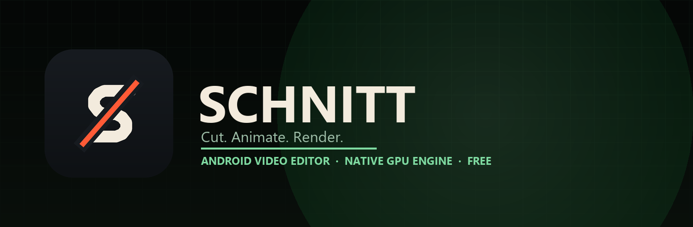

<div align="center">

<br/>
<br/>


# Schnitt

### Cut. Animate. Render.

**A focused Android video editor with a native GPU engine, a real timeline, and no paywalls.**


> This project is just for fun, yet it is taking most of my time fixing, improving, and adding more features into to the app. Sooner or later this project wil no longer be maintained.

<br/>

[](https://github.com/fleurdeur/Schnitt/releases)
[](https://github.com/fleurdeur/Schnitt/blob/main/LICENSE)
[](https://github.com/fleurdeur/Schnitt/releases)
[](https://github.com/fleurdeur/Schnitt/releases)

<br/>

[**Download**](#download) · [**Features**](#features) · [**Presets**](#presets) · [**Community**](#community) · [**Plugins**](#plugins) · [**Extensions**](#extensions) · [**Build**](#build) · [**Credits**](#credits)

<br/>



</div>

> [!IMPORTANT]
> Schnitt is an independent editor. It is not affiliated with Adobe, Alight Motion, After Effects, YouTube, SoundCloud, Deezer, Bandcamp, Mixkit, or their parent companies. Only use media you have the right to edit.

---

<div align="center">

<h1><a id="features"></a>Features</h1>

<table>
  <tr>
    <td width="50%" valign="top">

#### Timeline and animation
- **Layered timeline** with groups, masks, trims, splits, snapping, and multi-select.
- **Keyframes and easing** for every transform, effect and audio property.
- **Transform recording** — press record and move the layer while playback writes keys.
- **Puppet mesh** — Pin, Mesh and Sway sections for real mesh bending.
- **Auto Sway** — one tap adds procedural sway to puppet pins without keyframes.
- **Speed, time remap, reverse, smoothing, captions and motion tracking.**
- **Templates and presets** that open straight into an editable project.

#### Effects and shaders
- **GPU effect browser** for colour, blur, distort, light, retro, text, 3D and beat effects.
- **Beat detection** with Bass/Vocal/Full bands, sensitivity, BPM range and exact beat keyframes.
- **Real Depth Anything V2** depth maps for video layers with on-device ONNX inference.
- **Effect JSON import** and an AEX metadata/porting path.
- **Global shader effects** shared by preview, timeline and export.
- **Native plug-in effects** — AEX, CEP, JSXBIN and .ffx packages expose editable properties and a real effect in the normal Effects library.
- **Plugin controls** — every imported plug-in has its own property panel with sliders, switches, choices and colours.

    </td>
    <td width="50%" valign="top">

#### Audio
- **Audio layers** with volume, pitch, fades, speed mapping and a live meter.
- **Full audio effect rack** — EQ, filters, reverb, echo, compressor, gate, voice and pitch.
- **Audio effect preset JSON import.**
- **Audio extraction up to 320 kbps.**
- **Audio library** with Mixkit, custom pages, Deezer, Bandcamp and SoundCloud fallbacks.
- **yt-dlp add-on** with a one-time dependency install and direct insertion into the timeline.
- **High-quality preview playback** through Media3 ExoPlayer and OkHttp.

#### Export and compatibility
- **Video, audio, GIF and project export** with encoder fallbacks.
- **Universal APK** for ARMv7, ARM64 and x86_64.
- **Vulkan, Ganesh and OpenGL fallback** instead of device blacklists.
- **AMOLED green and green Daylight themes**, high-contrast text, and theme-aware preview.
- **No feature paywalls.** All included presets and effects are free to use.
- **Updates on open** — check the latest GitHub release on launch, from the Home sidebar, and choose whether to skip a version.

    </td>
  </tr>
</table>

</div>

---

<div align="center">

<h1><a id="download"></a>Download</h1>

<a href="https://github.com/fleurdeur/Schnitt/releases" target="_blank" rel="noopener noreferrer"></a>

Grab the latest signed APK from **[Releases](https://github.com/fleurdeur/Schnitt/releases)**.

| Package | Best for | Size |
| :--- | :--- | ---: |
| **Schnitt Universal** | Any supported phone, one APK | ~108 MB |
| **Schnitt ARM64** | Modern 64-bit phones | ~71 MB |
| **Schnitt ARMv7** | Older 32-bit phones | ~70 MB |

**Requirements:** Android 13 or newer, a 64-bit or 32-bit ARM device / x86_64 emulator, and Vulkan 1.1 or OpenGL ES 3.0.

</div>

---

<div align="center">

<h1><a id="presets"></a>Presets</h1>

A free preset library lives in **Home → Tools → Presets**. Pick a recipe, open it as a project, then edit every layer, keyframe and shader normally.

- **Colour** — Warm Clean, Cold Cinema, Film Fade, Amber Night
- **Shake** — Micro Shake, Beat Shake, Camera Glitch, Handheld
- **Light** — Soft Glow, Neon Edge
- **Retro** — VHS 1987, Pixel Fade
- **Motion** — Dream Blur, Speed Smear

The presets are built from Schnitt's own free effect shaders. They are not copied paid presets, and nothing is locked behind an account or a purchase.

</div>

---

<div align="center">

<h1><a id="community"></a>Community</h1>

Community presets and XML live on the **[Schnitt Community page](https://fleurdeur.github.io/Schnitt/community/)**.

- Upload a preset or XML directly.
- Every file shows **Pending** or **Approved**.
- The app reads only approved files and keeps them in one Community section with Presets and XML tabs.

</div>

---

<div align="center">

<h1><a id="plugins"></a>Plugins</h1>

Schnitt has a sandboxed plugin host for Adobe-style panels and effect packages.

- **ZXP** — CEP extension bundles with a floating, resizable HTML panel.
- **JSX / JSXBIN** — ExtendScript panels hosted in the sandbox.
- **AEX** — PE/PiPL metadata is read and the effect is ported to a compatible global shader with editable properties.
- **Floating windows** — minimize, restore, move, resize, reset and persist position.
- **Target layer picker** — apply a plugin effect to any layer on the timeline.
- **Undo-friendly** — plugin effects use the app's normal effect history.

Native Windows Adobe binaries cannot execute on Android. Where a binary cannot run, Schnitt ports its effect contract and exposes the compatible shader properties rather than pretending to execute the DLL.

</div>

---

<div align="center">

<h1><a id="extensions"></a>Extensions</h1>

Schnitt extensions are portable **`.sc`** bundles that customize the app without executing code. Install them from **Home → Tools → Extensions**, choose a category, change the properties the author declared, then restart Schnitt once to apply them.

| Category | What it can change |
| :--- | :--- |
| **Behavior** | Safe timeline behavior, including Auto Scroll and playback follow. |
| **Theme** | Palette colours through a small, sandboxed `theme.css` file. |
| **Icons** | A specific set of Home and Tools vector icons. |
| **Effects** | New effect definitions and their editable, keyframeable properties. |
| **Automation** | Safe playback automation such as looping at the scene end. |
| **Layout** | Supported layout choices, including the Tools column count. |

### Auto Scroll

The first extension is bundled and enabled by default. While the timeline plays, it eases the vertical scroll to the layer under the playhead. It never changes the playhead, the clock or playback speed. Its properties control the follow mode, snap-to-centre, speed and smoothing time.

### Make an extension

A `.sc` file is a ZIP with `manifest.json` at its **root** (no parent folder). The manifest declares a schema, a stable id, a category, the capabilities the app may read, and the properties the extension exposes.

```json
{
  "schema": 1,
  "id": "my-extension",
  "name": "My Extension",
  "version": "1.0.0",
  "author": "your-name",
  "description": "What this bundle changes.",
  "category": "theme",
  "capabilities": ["theme.css"],
  "properties": [
    {"id": "enabled", "label": "Enabled", "type": "toggle", "default": true}
  ]
}
```

Package it from inside the folder:

```bash
zip -r ../my-extension.sc manifest.json README.md theme.css
```

### How extension data maps into Schnitt

| Extension data | Target |
| :--- | :--- |
| `manifest.category` | The Extensions screen filter and required file set. |
| `capabilities[]` | The closed allowlist of readers: `timeline.follow`, `theme.css`, `icons.home`, `effects.custom`, `layout.tools`, `automation.safe`. |
| `properties[]` | Native controls in the extension card; values are stored by extension id and property id. |
| `theme.css` | Receives only `--palette-name: #hex`; maps to the 61 `Palette` fields used by `Am.*`. |
| `icons/icons.json` | Maps `home.projects`, `home.plugins`, `home.templates`, `home.tools` and `tools.extensions` to vector path data. |
| `effects/*.json` | Parsed as normal `EffectDefinition` objects and listed under **Imported** as `ext.<extension-id>.<effect-id>`. |
| `layout/*.json` | Reads `toolsColumns` (1–3) for the Tools grid. |
| `automation.safe` + `loopPlayback` | Uses the existing playback loop branch at the scene end. |
| `timeline.follow` + Auto Scroll properties | Drives only the timeline's vertical scroll; it never edits the frame, clock or scene. |

### Safe reader and limits

The extension reader only accepts `manifest.json`, `README.md`, `LICENSE`, `LICENSE.txt`, `theme.css`, `icons/icons.json`, `effects/*.json` and `layout/*.json`. It rejects path traversal, duplicates, executables, native libraries, images, HTML, scripts and oversized archives. Themes can only set palette colours, icons only receive vector path data, and effects are shader JSON. Extensions cannot read Schnitt's internal files, execute code or bypass app permissions.

Hard caps: 64 entries, 2 MiB per file, 8 MiB total, 64 KiB manifest/theme/icons, 24 properties, 32 icons, 24 effects and 4 layout files. Bundles are not signed; install from authors you trust.

The complete reference — every manifest field, property type, category mapping, the full 61-colour palette, effect JSON and shader contract, packaging commands, testing checklist, error table and versioning rules — is at **[fleurdeur.github.io/Schnitt/extensions.html](https://fleurdeur.github.io/Schnitt/extensions.html)**. The working **`auto-scroll.sc`** bundle is linked there and its source is in [`extensions/auto-scroll`](extensions/auto-scroll).

</div>

---

<div align="center">

<h1><a id="build"></a>Build</h1>

```bash
# ARM64 release
./gradlew :app:assembleFossRelease -PamAbi=arm64-v8a

# Universal release
./gradlew :app:assembleFossRelease -PamAbi=universal
```

**Toolchain**

- Android SDK 37 / build-tools 37
- NDK `30.0.16248370`
- JDK 21+
- CMake 3.31.6 and Ninja
- Skia and native third-party sources for a full native build

</div>

---

<div align="center">

<h1>Project layout</h1>

</div>

```text
android/            Android app, Gradle module and platform layers
shared/kotlin/      Compose UI, editor model, engine bridge
shared/cpp/         Native drawing, media and export engine
shared/res/         Translations and Android resources
shared/assets/      Effects, shapes, preset metadata, fonts
tools/              Build, verification and quality checks
testdata/           Test scenes and media samples
docs/               Repository artwork
```

The repository intentionally excludes generated native libraries, downloaded AI models, keystores, local SDK paths and APKs. Native binaries and signed APKs are attached to releases, and the Depth Anything V2 model downloads on demand inside the app.

---

<div align="center">

<h1><a id="credits"></a>Credits</h1>

**Schnitt** is built on the open-source AbsentMotion engine and UI, then extended with a new identity, theme, presets, audio library, plugin host, AEX importer, real Depth Anything V2 inference, transform recording and puppet workflow.

Special thanks to the upstream projects and libraries that make this possible:

- **Skia** — GPU drawing and text
- **ncnn / RIFE** — AI inference and frame interpolation
- **whisper.cpp** — on-device captions
- **RNNoise** — noise reduction
- **LAME** — MP3 encoding
- **ONNX Runtime** — Depth Anything V2
- **Media3 / ExoPlayer** — preview playback
- **OkHttp** — streaming audio transport
- **Kotlin, Jetpack Compose and AndroidX**

Third-party licences are listed in [THIRD_PARTY_NOTICES.md](THIRD_PARTY_NOTICES.md).

</div>

---

<div align="center">

<h1>Free and open</h1>

Schnitt has **no paywall, no account requirement, and no locked presets**. If you edit with it, keep the credits and share what you make.

</div>

---

<div align="center">

<h1>License</h1>

This project is licensed under the **GNU General Public License v3.0 (GPLv3)**. See the [LICENSE](LICENSE) file for details.

</div>
